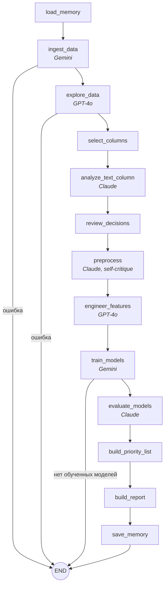
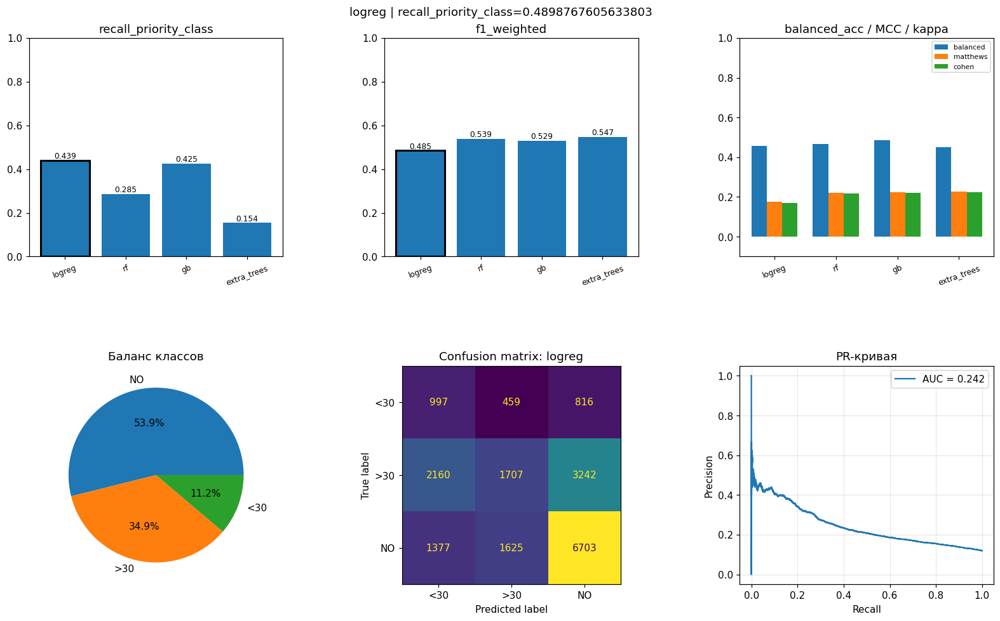

# СМАДИМО, ВШЭ БИ, 2026
# Групповой проект 3 - ИИ Агенты
# Команда 9
# Мультиагентная система для оценки риска повторной госпитализации

LLM-агенты на LangGraph, которые автоматически проводят ML-исследование на медицинских табличных данных: определяют задачу и целевую переменную, делают EDA, предобработку и инжиниринг признаков, обучают и сравнивают модели, а на выходе формируют список пациентов с наибольшим риском и HTML-отчёт.

## Задача

Клинике нужно заранее выделить пациентов, которые с высокой вероятностью вернутся в больницу в течение 30 дней после выписки, чтобы уделить им больше внимания. Система получает размеченный датасет, сама понимает предметную область, выбирает целевую переменную и метрику, ориентированную на бизнес-смысл (для медицинского риска важнее не пропустить пациента, поэтому основная метрика — recall приоритетного класса), и возвращает ранжированный список пациентов.

Пайплайн не привязан к конкретному датасету: задача, таргет и колонки определяются LLM по структуре данных.

## Архитектура

Граф на LangGraph из 13 узлов с условными ветвлениями и кратковременной (`State`) и долговременной (файловой) памятью.



| Узел | Что делает |
|---|---|
| `ingest_data` | Загружает датасет (URL или локальная папка), определяет предметную тему и целевую переменную (two-step prompting), классифицирует колонки |
| `explore_data` | EDA: пропуски, баланс классов, статистики, решение о балансировке |
| `select_columns`, `review_decisions` | Отбор признаков и проверка принятых LLM решений |
| `analyze_text_column` | Находит текстовую колонку (клиническую заметку) и предлагает доменные маркеры риска |
| `preprocess` | Импутация, фильтрация выбросов, кодирование; LLM сама проверяет план на утечку таргета |
| `engineer_features` | Сравнивает три стратегии генерации признаков и выбирает две (contrastive prompting) |
| `train_models` | Обучает LogReg, Random Forest, Gradient Boosting, Extra Trees с перебором гиперпараметров |
| `evaluate_models` | Выбирает стратегию метрик, лучшую модель и порог; вторая LLM верифицирует выбор |
| `build_priority_list`, `build_report` | Ранжирует пациентов по вероятности риска, собирает HTML-отчёт |
| `load_memory`, `save_memory` | Сравнение с лучшим результатом прошлых запусков |

**LLM.** Три модели через OpenRouter, каждая под свою роль: GPT-4o для аналитических шагов, Gemini 2.5 Flash Lite для коротких структурированных решений, Claude 3.5 Haiku для верификации. Перед запуском выполняется pre-flight проверка ключа и доступности моделей; если модель снята с OpenRouter, она автоматически заменяется на аналог из резервного списка.

Подробнее: [docs/architecture.md](docs/architecture.md).

## Результаты

Датасет: [Diabetes 130-US Hospitals (1999–2008)](https://archive.ics.uci.edu/dataset/296/diabetes+130-us+hospitals+for+years+1999-2008), 101 766 госпитализаций × 50 признаков. Целевая переменная `readmitted`: повторная госпитализация в течение 30 дней (`<30`, 11% наблюдений — приоритетный класс), после 30 дней (`>30`) или нет (`NO`).

| Модель | Recall `<30` | Precision `<30` | F1 weighted | PR-AUC `<30` |
|---|---|---|---|---|
| **Logistic Regression** (выбрана) | **0.44** | 0.22 | 0.48 | 0.24 |
| Gradient Boosting | 0.42 | 0.23 | 0.53 | 0.27 |
| Random Forest | 0.29 | 0.29 | 0.54 | 0.26 |
| Extra Trees | 0.15 | 0.28 | 0.55 | 0.24 |

После подбора порога классификации (0.35) recall приоритетного класса вырос до **0.49**: модель находит около половины пациентов, которые вернутся в течение 30 дней, при доле таких пациентов в данных 11%. Задача на этом датасете известна как трудная, и система осознанно выбирает модель с лучшим recall, а не с лучшей accuracy.



## Стек

Python, LangGraph, LangChain, OpenRouter (GPT-4o, Gemini 2.5 Flash Lite, Claude 3.5 Haiku), pandas, scikit-learn, matplotlib, seaborn, Jupyter.

## Структура

```
├── graph.py              # граф LangGraph и все узлы
├── notebooks/pipeline.ipynb
├── config/settings.env.template
├── docs/                 # архитектура, источники данных, инструкция
├── examples/             # результаты эталонного прогона
├── input/                # сюда кладётся датасет
└── artifacts/            # сюда пишутся результаты запуска
```
